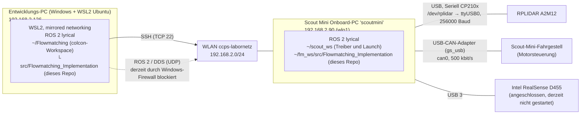
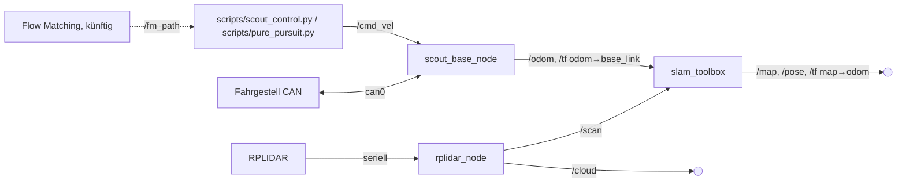

# Systemüberblick: Scout Mini, ROS 2 und Entwicklungs-PC

Dieses Dokument beschreibt, wie der Roboter aufgebaut ist, welche Software darauf
läuft und wie der Entwicklungs-PC mit ihm kommuniziert. Stand: 27.11.2026, aus dem
laufenden System ausgelesen.

---

## 1. Gesamtbild



Kurz gesagt: Der Onboard-PC des Roboters ist die zentrale Einheit. Sensoren und
Antrieb hängen per USB an ihm, und auf ihm laufen alle ROS-Nodes. Der PC verbindet
sich über das Labor-WLAN, heute nur per SSH. Direktes ROS (DDS) ist möglich, wenn
die Firewall geöffnet wird (siehe Abschnitt 5).

---

## 2. Hardware

| Bauteil | Details | Anbindung an den Onboard-PC |
|---|---|---|
| **Fahrgestell** | AgileX Scout Mini, Differentialantrieb (Skid-Steer) | CAN-Bus über USB-CAN-Adapter (Geschwister Schneider / gs_usb, `1d50:606f`), Interface `can0`, 500 kbit/s |
| **Onboard-PC** | Hostname `scoutmini`, Intel Core i5-1240P, 14 GB RAM, ~900 GB SSD | – |
| **Lidar** | Slamtec RPLIDAR A2M12, 2D, 360°, Reichweite bis 12 m | USB-Seriell (Silicon Labs CP210x, `10c4:ea60`); eine udev-Regel legt `/dev/rplidar → /dev/ttyUSB0` an, 256000 Baud |
| **Tiefenkamera** | Intel RealSense D455 | USB 3 (`8086:0b5c`). Im Launch-File auskommentiert, also aktuell ohne ROS-Daten |
| **WLAN 1** | Intel AX211 (`wlo1`) | Client im Labornetz `ccps-labornetz`, IP **192.168.2.90** |
| **WLAN 2** | Realtek USB-WLAN (`wlxcc641af149db`) | Eigener Access Point **`ScoutMiniAP`**, IP 192.168.90.1/24 (Notfall- oder Direktverbindung ohne Labornetz) |
| **Ethernet** | `enp114s0` | Kein Kabel angeschlossen |

**Montage Lidar:** Die feste Transformation `base_link → laser_frame` ist
x = 0,074 m, y = 0, z = 0,08 m, ohne Rotation.

---

## 3. Software auf dem Roboter

- **Betriebssystem:** Ubuntu 26.04.1 LTS, Kernel 7.0
- **ROS 2:** Distribution **lyrical** (`/opt/ros/lyrical`), Middleware **Fast DDS**
  (`rmw_fastrtps_cpp`), `ROS_DOMAIN_ID=0`, `ROS_AUTOMATIC_DISCOVERY_RANGE=SUBNET`
- **Login:** `ssh ccps@192.168.2.90` (Benutzer `ccps`, das Passwort steht bewusst nicht im Repo)

### Workspaces und Ordner

| Pfad | Inhalt | Git |
|---|---|---|
| `~/scout_ws` | colcon-Workspace mit den Treibern. Wird in `~/.bashrc` automatisch gesourct. | eigenes Repo |
| `~/scout_ws/src/scout_driver` | `scout_base`, `scout_msgs`, `scout_description` | `github.com/agilexrobotics/scout_ros2` |
| `~/scout_ws/src/ugv_sdk` | AgileX-SDK, spricht das CAN-Protokoll | `github.com/agilexrobotics/ugv_sdk` |
| `~/scout_ws/src/scoutmini_launch` | Launch-File und Konfiguration (`rplidar.yaml`, `scout_base.yaml`, `slam_toolbox.yaml`, `realsense.yaml`) | `git-ce.rwth-aachen.de:ccps/lab/devices/agilex/scoutmini_ws` |
| `~/fm_ws/src/Flowmatching_Implementation` | **Dieses Repo** (Klon von GitHub), u. a. `scripts/scout_control.py` und `scripts/pure_pursuit.py` | `github.com/NobbisCode/Flowmatching_Implementation` |
| `~/fm_ws/*.py` | Ursprüngliche, unversionierte Kopien von `scout_control.py` und `pure_pursuit.py`. Veraltet, maßgeblich ist das Repo. | – |
| `~/bags` | Aufgezeichnete rosbags | – |

### Start

```bash
scoutlaunch   # Alias für: ros2 launch scoutmini_launch scoutmini.launch.py
```

### Laufende Nodes

| Node | Paket | Aufgabe |
|---|---|---|
| `scout_base_node` | `scout_base` | Spricht über `can0` mit dem Fahrgestell. Empfängt `/cmd_vel`, publiziert `/odom`, `/tf` (odom→base_link), `/scout_status`, `/rc_status`. Läuft mit 50 Hz. |
| `rplidar_node` | `rplidar_driver` | Liest den Lidar und publiziert `/scan` und `/cloud` |
| `base_to_laser` | `tf2_ros` | Statische TF `base_link → laser_frame` |
| `robot_state_publisher` | – | Roboter-Modell (URDF) → `/robot_description`, `/tf_static` |
| `slam_toolbox` | `slam_toolbox` (async) | Baut aus `/scan` und `/odom` eine Karte (`/map`), liefert `/pose` und TF `map → odom` |

### Wichtige Topics

| Topic | Typ | Quelle | Rate / Bemerkung |
|---|---|---|---|
| `/scan` | `sensor_msgs/LaserScan` | rplidar_node | ~9,2 Hz, 1450 Strahlen über 0…2π, Winkelschritt ≈ 0,248°, `range_max` 12 m, keine Intensitäten |
| `/cloud` | `sensor_msgs/PointCloud2` | rplidar_node | Dieselben Daten als Punktwolke, QoS BEST_EFFORT |
| `/odom` | `nav_msgs/Odometry` | scout_base_node | ~50 Hz |
| `/cmd_vel` | `geometry_msgs/Twist` | Eingang | Fahrbefehle (linear.x, angular.z). Ohne fortlaufende Befehle bleibt der Roboter stehen. |
| `/tf`, `/tf_static` | `tf2_msgs/TFMessage` | mehrere | Frame-Baum, siehe unten |
| `/map` | `nav_msgs/OccupancyGrid` | slam_toolbox | Karte |
| `/pose` | `geometry_msgs/PoseWithCovarianceStamped` | slam_toolbox | Pose in der Karte |
| `/scout_status`, `/rc_status` | `scout_msgs/...` | scout_base_node | Akku- und Motorstatus, Fernbedienung |
| `/light_control` | `scout_msgs/ScoutLightCmd` | Eingang | Licht |

### Frame-Baum (TF)

```
map ──(slam_toolbox)──▶ odom ──(scout_base_node)──▶ base_link ──(static)──▶ laser_frame
                                                        └──(robot_state_publisher)──▶ Räder usw.
```

### Datenfluss auf dem Roboter



---

## 4. Entwicklungs-PC

- Windows mit **WSL2 (Ubuntu)**. `.wslconfig` setzt `networkingMode=mirrored`, deshalb
  hat WSL direkt die LAN-IP **192.168.2.126**, und `firewall=true` ist aktiv.
- ROS 2 **lyrical** unter `/opt/ros/lyrical`, `ROS_DOMAIN_ID=0`, also dieselbe
  Distribution wie auf dem Roboter. Das ist nötig, damit die Nachrichtentypen zusammenpassen.
- colcon-Workspace `~/Flowmatching` (`build/`, `install/`, `log/`, `src/`).
- Dieses Repo: `~/Flowmatching/src/Flowmatching_Implementation`,
  Remote `github.com/NobbisCode/Flowmatching_Implementation`.

---

## 5. Verbindungen zwischen PC und Roboter

### 5.1 SSH / SCP (funktioniert)

```bash
ssh ccps@192.168.2.90                                # Shell auf dem Roboter
scp -r ccps@192.168.2.90:bags/<name> data/           # Daten zum PC holen
```

Darüber läuft alles, was der PC heute mit dem Roboter macht: Nodes starten, Daten
aufzeichnen, Dateien kopieren.

### 5.2 ROS 2 / DDS direkt (geht erst nach Firewall-Änderung)

ROS 2 hat keinen Master. Jeder Node findet die anderen über die **DDS-Discovery**:
Er schickt UDP-Multicast-Pakete ins Netz (Ports ab 7400). Alle Teilnehmer mit derselben
`ROS_DOMAIN_ID` (hier 0) und demselben Subnetz sehen sich dann gegenseitig und tauschen
die Daten per UDP-Unicast aus. Wenn das klappt, kann der PC direkt
`ros2 topic echo /scan`, `rviz2` oder `ros2 bag record` auf die Topics des Roboters
ausführen und auch `/cmd_vel` oder `/fm_path` senden.

**Aktueller Stand:** Vom PC aus ist nur `/rosout` und `/parameter_events` sichtbar. Tests ergaben:

- Ping vom Roboter zum PC funktioniert.
- UDP vom Roboter zum PC kommt **nicht** an, auch nicht mit `ROS_STATIC_PEERS=192.168.2.90`.
- Ursache: die **Hyper-V-Firewall von WSL** (`firewall=true` in `.wslconfig`) blockiert eingehendes UDP.

**Lösung** (eine der beiden):

```powershell
# Admin-PowerShell: eingehende Verbindungen für WSL erlauben
Set-NetFirewallHyperVVMSetting -Name '{40E0AC32-46A5-438A-A0B2-2B479E8F2E90}' -DefaultInboundAction Allow
```

oder in `C:\Users\<user>\.wslconfig` `firewall=false` setzen und danach `wsl --shutdown` ausführen.

Danach prüfen mit:
```bash
ros2 topic list            # sollte /scan, /odom, /map ... zeigen
ros2 topic hz /scan
```

Tipp: Im WLAN kann Multicast unzuverlässig sein. Hilft das nicht, schränkt
`export ROS_STATIC_PEERS=192.168.2.90` (auf dem PC) bzw. `=192.168.2.126` (auf dem
Roboter) die Discovery auf feste Adressen ein.

### 5.3 Git (Code-Austausch über GitHub)

```
PC  ──git push──▶  GitHub (NobbisCode/Flowmatching_Implementation, öffentlich)  ──git pull──▶  Roboter
```

Code wird auf dem PC entwickelt, nach GitHub gepusht und auf dem Roboter mit `git pull`
geholt. Der Roboter liest anonym über HTTPS. Will man vom Roboter aus pushen, braucht er
eigene Zugangsdaten, z. B. einen Deploy-Key mit Schreibrecht.

### 5.4 Direktverbindung über `ScoutMiniAP`

Der Roboter spannt zusätzlich ein eigenes WLAN `ScoutMiniAP` auf (Roboter = 192.168.90.1).
Damit erreicht man ihn auch ohne Labornetz: `ssh ccps@192.168.90.1`.

---

## 6. Lidardaten aufzeichnen und ins Repo legen

Empfohlen wird, **auf dem Roboter** aufzuzeichnen. Das ist unabhängig von WLAN und
Firewall, es gehen keine Nachrichten verloren, und danach wird die Datei kopiert.

```bash
# 1) Auf dem Roboter, während scoutlaunch läuft:
ssh ccps@192.168.2.90
mkdir -p ~/bags && cd ~/bags
ros2 bag record -o <name> -s mcap --topics /scan /tf /tf_static /odom
# Ctrl+C beendet die Aufnahme
# Hinweis: In lyrical müssen die Topics hinter --topics stehen.

# 2) Auf dem PC, im Repo:
scp -r ccps@192.168.2.90:bags/<name> data/
ros2 bag info data/<name>
```

- **Format:** MCAP (`.mcap` plus `metadata.yaml`), lesbar mit `ros2 bag play`,
  `rosbag2_py` oder Foxglove.
- **Größe:** ~6 MB/min für `/scan`, `/odom` und `/tf`. `/cloud` nur bei Bedarf
  mitschneiden, es ist redundant zu `/scan` und deutlich größer.
- **Git:** Kleine Beispiel-Aufnahmen können direkt ins Repo. Für größere Aufnahmen
  Git LFS nutzen (`git lfs track "*.mcap"`), denn GitHub erlaubt höchstens 100 MB pro Datei.

### Vorhandene Daten

| Ordner | Dauer | Topics | Größe |
|---|---|---|---|
| `data/scan_sample/` | 11,5 s | `/scan` (106), `/odom` (577), `/tf` (1153), `/tf_static` (2) | 1,2 MB |
